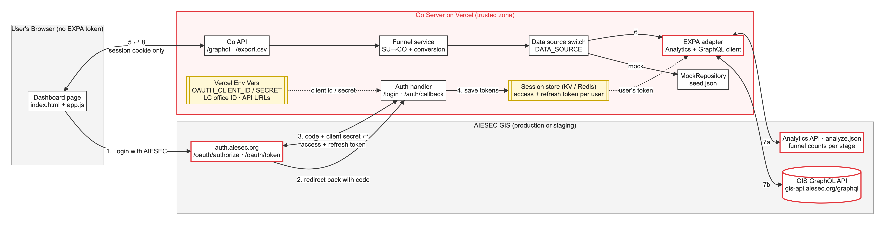
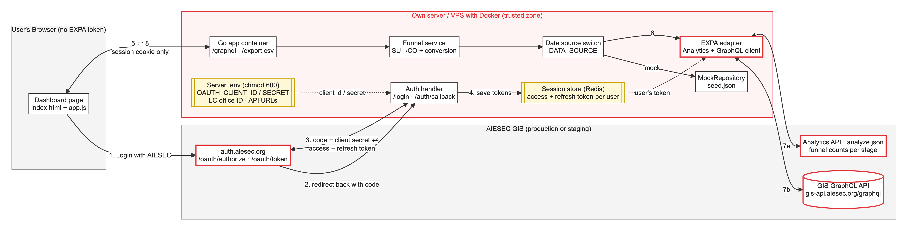

# LC Performance Dashboard: AIESEC in Universitas Brawijaya

A one-page dashboard that shows the oGX and iCX funnel (SU → APL → ACC → APD → RE → FIN → CO)
and conversion rates for a chosen date range, loaded via **GraphQL**, with a **CSV export**.

- **Live:** https://neval-iid-staff-technicaltask.vercel.app
- **Stack:** Go (`net/http` + `gqlgen` GraphQL), plain HTML/CSS/JS + Chart.js, deployed on Vercel

> **Data status:** no EXPA access token was available during development, so the app runs on
> **mock data** shaped like EXPA data. It is labelled "Data: Mock (dummy)" in the UI and in every
> exported CSV. Switching to EXPA is one adapter plus one env var (see below).

---

## Architecture

### Current deployment (Vercel)



### Alternative: self-hosted on a VPS



> The diagrams show the **planned EXPA integration with "Login with AIESEC" (OAuth 2.0)**,
> following AIESEC International's developer guides. The live prototype currently runs on mock
> data, so the login and EXPA adapter are the next step, not live yet.

**Key idea:** users log in with their own AIESEC account. Our server exchanges the login for
tokens and keeps them server-side, so the browser only ever holds a session cookie. Each user only
sees data their EXPA account is allowed to see. The `DATA_SOURCE` env var picks mock or EXPA, and the
rest of the code (UI, GraphQL schema, funnel logic) does not change.

| Step | What happens |
|---|---|
| 1 | The user clicks "Login with AIESEC" and is redirected to `auth.aiesec.org/oauth/authorize` (with our `client_id` and `redirect_uri`). |
| 2 | After signing in, AIESEC redirects back to our `/auth/callback` with a temporary `code`. |
| 3 | **Server-to-server:** our server sends the `code` + `client_id` + `client_secret` to `auth.aiesec.org/oauth/token` and receives an `access_token` (~2 h) and a `refresh_token`. |
| 4 | Tokens are saved in a server-side session store. The browser only gets an HttpOnly session cookie. |
| 5 ⇄ 8 | The dashboard asks our API for a date range and oGX/iCX, and gets numbers back (JSON or CSV). |
| 6 | `DATA_SOURCE=expa` sends the request to the EXPA adapter, which uses **that user's** token. If it has expired, the server refreshes it with the refresh token. |
| 7a | **Analytics API** (`analyze.json`): LC office ID + start/end date → counts per programme and stage (applied, accepted, approved, realized, finished, completed). |
| 7b | **GIS GraphQL API** (`gis-api.aiesec.org/graphql`, token in the `Authorization` header): extra data the analytics response does not cover. |

Only `client_id`, `client_secret`, the LC office ID and the API URLs live in env vars. User tokens
are never stored in env vars, the repo or the browser.

For development, the same flow points to AIESEC's **staging** environment
(`auth-staging.aiesec.org`, `staging-jruby.aiesec.org/graphql`) by changing the URL env vars.

---

## Run locally

Requirements: Go 1.26+ (Go downloads the toolchain automatically if you have 1.21+).

```bash
cd backend
go run ./cmd/server
```

Open http://localhost:8080. The server also serves the frontend from `../frontend`, so frontend
edits show on refresh.

Other useful URLs:
- http://localhost:8080/playground: GraphQL playground to try queries
- http://localhost:8080/export.csv?programme=OGX&start=2026-01-01&end=2026-11-26: CSV report

Run the tests:

```bash
cd backend
go test ./...
```

### Environment variables

| Variable | Default | Meaning |
|---|---|---|
| `DATA_SOURCE` | `mock` | `mock` (seed data) or `expa` (real EXPA API) |
| `EXPA_ACCESS_TOKEN` | – | current stub's config for `DATA_SOURCE=expa`, server-side only |
| `PORT` | `8080` | port for the server |
| `OAUTH_CLIENT_ID` / `OAUTH_CLIENT_SECRET` | – | *planned:* "Login with AIESEC" app credentials |
| `OAUTH_REDIRECT_URI` | – | *planned:* e.g. `https://<domain>/auth/callback` (HTTPS only) |
| `EXPA_OFFICE_ID` | – | *planned:* the LC's office ID for the Analytics API |

See `backend/.env.example`. The server reads normal environment variables, so load a local
`.env` first: `set -a && source .env && set +a`.

---

## Switch from mock to EXPA

1. In EXPA, create a developer application (`auth.aiesec.org/developers/oauth_applications`)
   with redirect URI `https://<domain>/auth/callback`, and wait for AIVP IM approval.
   Copy the application's UID (client ID) and secret.
2. Find the LC's office ID, and test the requests in Postman/Altair first, ideally on staging
   (`auth-staging.aiesec.org`, `staging-jruby.aiesec.org/graphql`).
3. Add the auth handler (`/login`, `/auth/callback`, token refresh) and a server-side session store.
4. Implement the adapter in `backend/internal/repository/expa/expa.go` (the TODO lists the steps),
   using the logged-in user's token. Use the Analytics API for funnel counts and the GraphQL API for
   anything else. Load the GraphQL docs in a client; don't guess field names.
5. Set `DATA_SOURCE=expa` and the OAuth env vars (in Vercel: Settings → Environment Variables).
6. Redeploy. The UI badge changes to "Data: EXPA live".

---

## How a future team can update it

```
backend/
├── cmd/server/            → entry point: routes, config from env
├── cmd/seed/              → regenerates mock data: go run ./cmd/seed
├── graph/schema.graphqls  → GraphQL schema (the API contract)
├── graph/*.resolvers.go   → resolvers: thin, call the service
├── internal/domain/       → phases, date range, funnel + conversion rules
├── internal/service/      → use case + repository interface
├── internal/repository/   → mock/ (seed.json) and expa/ (EXPA API)
├── internal/export/       → CSV report
├── web/                   → embeds the frontend into the binary for deploys
└── vercel.json            → Vercel build
frontend/                  → index.html, styles.css, app.js
```

- **Change the GraphQL API:** edit `graph/schema.graphqls`, then run `go tool gqlgen generate`
  inside `backend/`, then fill the new resolver stubs.
- **Add a phase or metric:** add it to `Phases` in `internal/domain/funnel.go` and to the `Phase`
  enum in the schema. Regenerate, then add the label in `frontend/app.js` (`PHASE_NAMES`).
- **Change the funnel maths:** `internal/domain/funnel.go`, with tests in `funnel_test.go`.
- **Change the page:** `frontend/`. No build step.
- **Deploy:** push to `master`; Vercel builds `backend/` automatically.

---

## Security: keeping the EXPA API key secret

- **Login with AIESEC (OAuth 2.0):** no shared long-lived token. Each user's access follows their
  own EXPA permissions, and their tokens expire in ~2 h and are refreshed server-side.
- **App secrets** (`client_secret`, office ID, API URLs) live only in server env vars: a local
  `.env` (git-ignored) or Vercel Environment Variables (marked Sensitive). Never in the repo or
  in frontend code.
- **User tokens** stay in a server-side session store. The browser gets only an HttpOnly, Secure
  session cookie. The code-for-token exchange happens server-to-server.
- The browser never calls EXPA. It calls our `/graphql` and `/export.csv`.
- Tokens are never logged, and request URLs to EXPA are not logged either (the Analytics API takes
  the token as a URL parameter). Internal errors are logged on the server, and the browser gets a
  generic message (covered by a unit test).
- If the token leaks: revoke it in the developer application and rotate the secret.

---

## What went wrong

See [DEVLOG.md](DEVLOG.md) for the full log.

| What went wrong | How I handled it |
|---|---|
| Vercel deploy failed: it expected one Go binary, not `api/` functions. | Read the build log, built one Go server with the frontend embedded, tested locally. Fixed. |
| GraphQL requests rejected: missing `Content-Type: application/json`. | Added the header in tests and documented it below. |

Calling the API with `curl`:

```bash
curl -s https://neval-iid-staff-technicaltask.vercel.app/graphql \
  -H 'Content-Type: application/json' \
  -d '{"query":"{ funnel(programme: OGX, startDate: \"2026-01-01\", endDate: \"2026-11-26\") { phases { phase count } } }"}'
```
